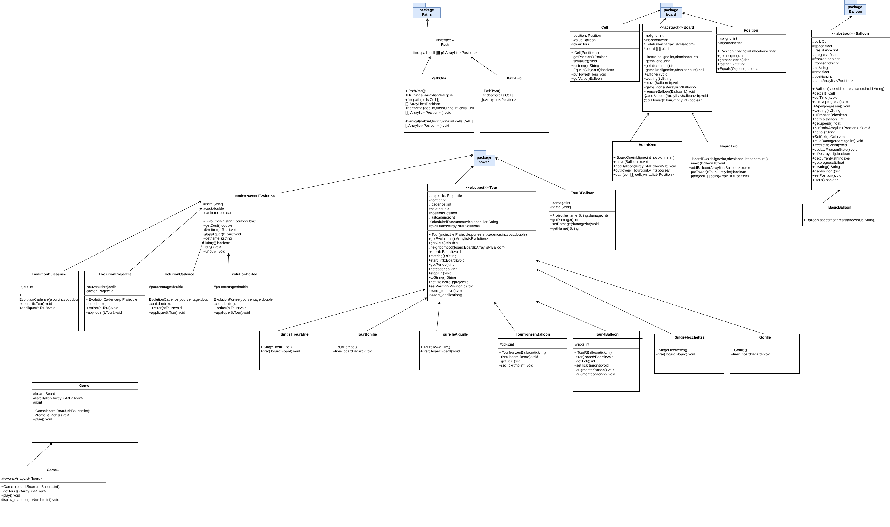
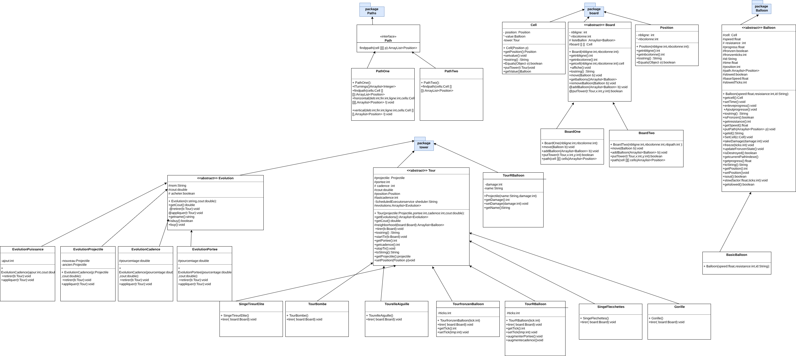
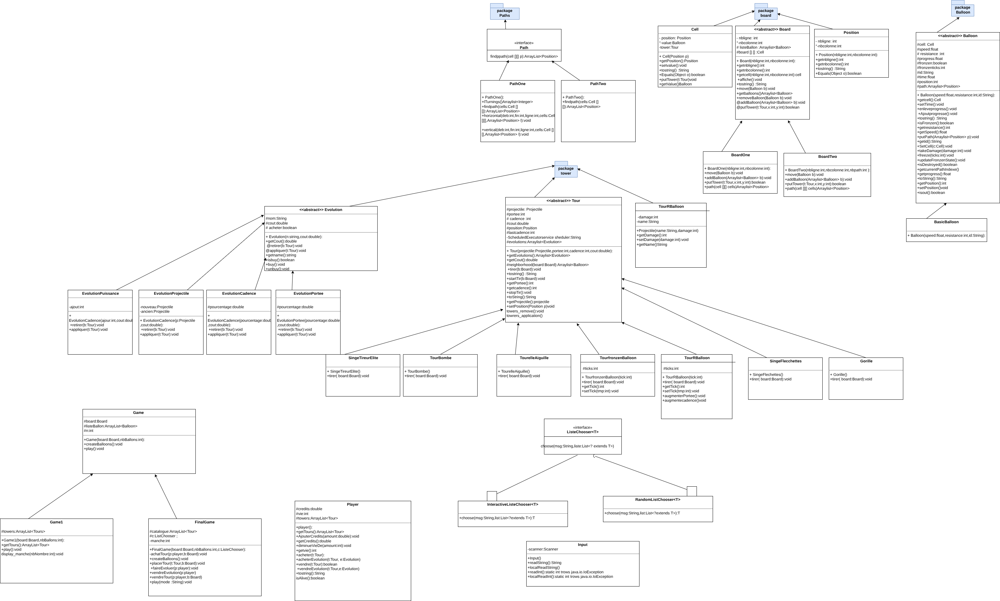

# l2s4-projet-2026

Vous devez *forker* ce projet dans votre espace de travail Gitlab (bouton `Fork`) et vidéo sur le [portail](https://www.fil.univ-lille.fr/portail/index.php?dipl=L&sem=S4&ue=Projet&label=Documents)
Un unique fork doit être réalisé par équipe.

Une fois cela réalisé, supprimer ces premières lignes et remplir les noms des membres de votre équipe.
N'oubliez pas d'ajouter les autres membres de votre équipe aux membres du projet, ainsi que votre enseignant·e (statut Maintainer).

# Equipe 1

- IBRAHIMA DIALLO
- ALPHA ABDOULAYE DIALLO
- KERIM ABDOULAYE MAHAMAT ALHAFIZ 
- THIERNO ABDOULAYE DIALLO

# Sujet

[Le sujet 2026](https://www.fil.univ-lille.fr/~varre/portail/l2s4-projet/sujet2026.pdf)

# Livrables

Les paragraphes concernant les livrables doivent être remplis avant la date de rendu du livrable. A chaque fois on décrira l'état du projet par rapport aux objectifs du livrable. Il est attendu un texte de plusieurs lignes qui explique la modélisation choisie, et/ou les algorithmes choisis et/ou les modifications apportées à la modélisation du livrable précédent.

Un lien vers une image de l'UML doit être fourni (une photo d'un diagramme UML fait à la main est suffisant).

## Livrable 1 Plateaux et chemins

##  Modélisation du plateau

Le plateau est modélisé par une classe abstraite `Board`.

Deux implémentations concrètes ont été créées :

- `BoardOne` : plateau avec un chemin unique  
- `BoardTwo` : plateau avec plusieurs trajectoires indépendantes  

### Pourquoi ce choix ?

Ce choix permet :

- de gérer plusieurs modes de jeu  
- de factoriser les comportements communs  
- de faciliter l’ajout de nouveaux types de plateaux  

---

## Modélisation des chemins

Nous avons créé une **interface `Path`**.

Chaque type de chemin implémente cette interface :

- `PathOne` → chemin avec tournants  
- `PathTwo` → trajectoires droites  

### Pourquoi ce choix ?

- séparer la logique des chemins du plateau  
- faciliter l’extensibilité  
- respecter le principe Ouvert/Fermé  

---
### INSTRUCTIONS PRECISES :
### COMPILATION DU PROGRAMME
Pour compiler notre  programme, il faut executer cette commande:
```javac -sourcepath src src/TowerDefence/*.java -d classes ``` 

 
### GENERERATION DU DOC :
Pour generer la documentation il faut executer cette commande :
```javadoc -sourcepath src -subpackages TowerDefence -d docs ```
 

### COMPILATION Des tests:
Pour compiler et executer  qui m'ont ete demandes de resoudre dans ce tp il faut executer cette commande :
```javac -classpath "junit-console.jar;classes"  test/TowerDefence/*.java``

Pour l'exécuter :
 ``` java -jar junit-console.jar -classpath "test;classes" -scan-classpath ```


### EXECUTION DU PROGRAMME :
Il peut se faire en deux etapes soit :sans jar executable soit avec .
### Pour exécuter le programme sans le jar exécutable 
Pour exécuter le  programme de  il suffit de taper la commande ci apres :
### Pour le livrable1a: 
 ``` java -classpath classes TowerDefence.Livrable1aMain   ```
 NB:Ensuite juste apres Livrable1a.Main rajouter les coordonnées que vous vouliez pour votre grille .
### Pour le livrable1b:
``` java -classpath classes TowerDefence.Livrable1bMain   ```
NB:Ensuite juste devant Livrable1b.Main rajouter les coordonnées que vous vouliez pour votre grille et le nombre total  de  chemin que vous souhaitez.(longueur,largeur,nbchemins).


###  Pour exécuter le programme avec le jar exécutable 
Celui la aussi se fait soit avec un fichier manifeste soit sans fichier manifeste :
## sans fichier manifeste :
Il faut compiler cette commande : 
### Pour le livrable1a:
``` jar cvfe Livrable1a.jar TowerDefence.Livrable1aMain -C classes TowerDefence  ```

Ensuite pour l'executer : ``` java -jar Livrable1a.jar   ```
NB:Ensuite juste devant Livrable1a.jar rajouter les coordonnées que vous vouliez pour votre grille(Longueur,Largeur).

### Pour le livrable1b:
``` jar cvfe Livrable1b.jar TowerDefence.Livrable1bMain -C classes TowerDefence  ```

Ensuite pour l'executer : ``` java -jar Livrable1b.jar   ```
NB:Ensuite juste devant Livrable1b.Main rajouter les coordonnées que vous vouliez pour votre grille et le nombre total  de  chemin que vous souhaitez.(longueur,largeur,nbchemins).

## Avec fichier manifeste :
### Pour le livrable1a:
il faut d'abord creer un fichier manifeste nous  ici on a creer   le fichier " TowerDefence" comme manifeste puis à l'interieur on a  mis "Main-Class: TowerDefence.Livrable1aMain
NB: dans ce fichier il doit y avoir 2 lignes a l'interieur.(la seconde est vide)

 Ensuite il faut taper la commande : ``` jar cvfm Livrable1a.jar TowerDefence-manifest -C classes TowerDefence ```

 Et enfin l'exécuter : ``` java -jar Livrable1a.jar  ```
 NB:Ensuite juste devant Livrable1a.jar rajouter les coordonnées que vous vouliez pour votre grille(Longueur,Largeur).

 ### Pour le livrable1b:
 il faut d'abord creer un fichier manifeste nous  ici on a creer   le fichier " TowerDefence1" comme manifeste puis à l'interieur on a  mis "Main-Class: TowerDefence.Livrable1bMain
 NB: dans ce fichier il doit y avoir 2 lignes a l'interieur.(la seconde est vide)

 Ensuite il faut taper la commande : ``` jar cvfm Livrable1b.jar TowerDefence-manifest -C classes TowerDefence ```

 Et enfin l'exécuter : ``` java -jar Livrable1b.jar  ```
 NB:Ensuite juste devant Livrable1b.Main rajouter les coordonnées que vous vouliez pour votre grille et le nombre total  de  chemin que vous souhaitez.(longueur,largeur,nbchemins).


### Atteinte des objectifs

### Difficultés restant à résoudre

## Livrable 2
# Choix de modelisation

## Modélisation des ballons

Les ballons sont représentés par une **classe abstraite `Balloon`**.

Tous les ballons partagent :

- position  
- vitesse  
- résistance  
- progression  


### Pourquoi ce choix ?

- éviter la duplication de code  
- faciliter l’ajout de nouveaux types de ballons  
- permettre le polymorphisme  

---

## Stockage des ballons

Les ballons sont stockés directement dans la classe `Board`.

### Pourquoi ce choix ?
Nous avons longuement discuter de ou mettre les ballons puis nous nous sommes dis que dans board on aura plus de marge de manoeuvre.
Cela permet :

- une gestion globale des ballons  
- un déplacement simplifié  
- une meilleure cohérence de la simulation  

---
### INSTRUCTIONS PRECISES :
### COMPILATION DU PROGRAMME
###Pour compiler notre  programme, il faut executer cette commande:
```rm -rf classes/*
javac -sourcepath src -d classes \
  src/TowerDefence/Livrable2aMain.java \
  src/TowerDefence/Livrable2bMain.java
```
###pour executer :
    ```java -classpath classes TowerDefence.Livrable2bMain param param parm(sachant que des entier)``
###pour la cretation du jar executable  du livrable2b et livrable1a :
    ```jar cvfe Livrable2b.jar TowerDefence.Livrable2bMain -C classes .```
    ```jar cvfe Livrable2a.jar TowerDefence.Livrable2aMain -C classes .```
pour l'execution avec le jar :
    ``` java -jar Livrable2b.jar parm parm parm parm ```
     ``` java -jar Livrableab.jar parm parm parm parm ```
pour la documentation:
```javadoc -sourcepath src -subpackages TowerDefence -d docs ```


### Atteinte des objectifs
pour le livrable2b
Création d’un plateau aléatoire de taille paramétrable

Génération de chemins rectilignes aléatoires

Création de ballons avec des vitesses aléatoires

Déplacement des ballons le long des chemins en fonction du temps (ticks)

Arrêt automatique de la simulation lorsque tous les ballons ont terminé leur parcours

Affichage de l’état du plateau à chaque tick

Mise en place de tests unitaires pour les méthodes publiques principales

Compilation, exécution et lancement des tests via la ligne de commande

### Difficultés restant à résoudre
   
## Livrable 3

# Choix de modelisation Tours et tir

##  Modélisation des tours

Les tours sont représentées par une **classe abstraite `Tour`**.

Chaque type de tour hérite de cette classe.

Toutes les tours possèdent :

- une portée  
- une cadence  
- un projectile  
- une position  
Mais chaque tour tire de differente maniere et les ballons sur les quels sont tirees sont aussi choisi differement

### Pourquoi ce choix ?

- factoriser le code commun  
- permettre des comportements de tir différents  
- simplifier l’ajout de nouvelles tours  

---

## Gestion du tir automatique

Chaque tour utilise un `ScheduledExecutorService` pour tirer automatiquement.
Cet element une connaisance recente(on a effectue des recherches pour trouver ce module) nous pensons la cadence comme le temps entre chaque tire (de ce fait une tour avec 100ms de cadence executera sa methode tirer apres chaque 100ms et faudra pas oublier qu une evolution servira a diminuer ce temps pas à l augmenter)

### Pourquoi ce choix ?

- gestion du temps indépendante  
- cadence spécifique à chaque tour  


---

##  Modélisation des projectiles

Les projectiles sont représentés par une classe `Projectile`.
l'ajout de nouveau projectille ne sera pas un probleme juste son nom et son nombre de degat.

### Pourquoi ce choix ?

- permettre des dégâts variables  
- faciliter le changement de projectile  
- simplifier les évolutions  

###les commades pour la compilation:

### pour compiler:
```make classes```
### pour la cretation du jar executable  du livrable3b et livrable3a :
    ```make jar ```
### pour l'execution du jar
```java -jar livrable3a.jar parm parm parm```
```java -jar livrable3b.jar parm parm parm```
### pour la documentation:
```make docs ```
### pour le test
```make test ```
### pour executer :
    ```make runtests```
### pour  supprimer les compilé :
    ```make clean```

 
### Atteinte des objectifs

### Difficultés restant à résoudre

## Livrable 4
# choix de modelisation


##  Modélisation des évolutions

Les évolutions seront modélisées par des **classes dédiées `Evolution`**.
toutes heriteront de la classe abtraite `Evolution` qui aura de methode abstraite `appliquer et retirer`ces deux methodes respectivement applique l effet de l evolution ou le retire au besoin
Chaque évolution :

- possède un coût  
- ne peut être appliquée qu’une seule fois  
- peut être cumulée  
- peut être revendue  
- modifie les caractéristiques de la tour  

### Pourquoi ce choix ?

- séparer la logique des améliorations des tours  
- faciliter l’ajout de nouvelles évolutions  
---

### Atteinte des objectifs
les classes compilent correctement et tout est  clair .
### Difficultés restant à résoudre
### pour compiler:
````make classes```
### pour la cretation du jar executable  du livrable4b et livrable4a :
```make jar```
### pour l'execution du jar
```java -jar livrable4a.jar parm parm parm ```
```java -jar livrable4b.jar parm parm parm ```
### pour la documentation:
```make docs``` 
### pour le test
```make test``` 
### pour executer les tests:
```make  runtests```
### pour  supprimer les compilé :
```make  clean```
## Livrable 5

### Atteinte des objectifs
-Création de la classe Player Diallo Alpha Abdoulaye
-definissions des methodes pour leur actions.Diallo Alpha Abdoulaye
### Commande
### pour compiler:
````make classes```
### pour la cretation du jar executable  du livrable5b et livrable5a :
```make jar```
### pour l'execution du jar
```java -jar livrable5a.jar  parm parm parm parm ```
```java -jar livrable5b.jar parm parm parm parm ```
### pour la documentation:
```make docs``` 
### pour le test
```make test``` 
### pour executer les tests:
```make  runtests```
### pour  supprimer les compilé :
```make  clean```

### Difficultés restant à résoudre
pour aujourd'hui il reste à résoudre les beugs  et la gestion  aléatoire du jeu . c'est -à-dire le mode automatic en utilisant ListChooser , la simplification des responsabilités de la classe Ballon , avant qu'on reçoive le mail . les test pour la classe Player , et aussi pour couvrir en fait tout ce que doit faire le livrable 5 .   

## Livrable 6

### Atteinte des objectifs

### Difficultés restant à résoudre

# Journal de bord

Le journal de bord doit être rempli à la fin de chaque séance encadrée, et **avant** de quitter la salle. 

Depuis le début du projet, nous avons rencontré, entre autres, quelques difficultés. Nous avions des idées divergentes sur le concept, mais le plus grand problème était la fébrilité de certains membres du groupe au moment de rendre le livrable 2.

Nous nous sommes rendu compte que tout allait de travers. Nous avons donc convoqué une réunion le vendredi après les cours. Pendant cette réunion, chacun a pu donner son point de vue et exprimer ses ressentis. Les discussions ont été houleuses, mais une fois que chacun a accepté sa part de responsabilité, nous avons repris tout le projet ensemble et réorganisé le diagramme UML du livrable 2, car nos ballons n’avaient pas le bon comportement. Nous avons également fixé un délai pour chaque membre et pour son travail.

Malheureusement, ce délai n’a pas été respecté et nous étions donc en retard une fois de plus. Nous aurions normalement dû être en train de travailler sur le livrable 3, mais avec les DS qui approchaient, la situation ne s’est pas améliorée.

Nous nous sommes de nouveau réunis. Les membres concernés ont accepté leur part de responsabilité et nous avons tenu une séance de code collective, qui a été fructueuse. Le livrable 2 a finalement bien fonctionné et les ballons se comportent correctement.

Le livrable 3 a été réalisé un peu au dernier moment, mais cette fois le retard n’était plus dû à un membre en particulier. Les DS nous ont beaucoup ralentis. Dès le jeudi 19, nous nous y sommes remis. Nous avons corrigé l’UML que Ibrahima et Thierno avaient réalisé pour le livrable 3.

Dans une bonne ambiance, souvent en ligne et au téléphone, nous avons codé ensemble. Le travail avait été réparti à l’avance et chacun a apporté son aide aux autres, par exemple pour trouver le ballon le plus proche de la sortie Kerim et Alpha y ont travailé ensemble.

Notre constat est qu’une bonne ambiance de groupe et la volonté de chacun permettent d’avancer plus vite.

Le livrable 4 est en cours à ce jour, lundi 23 février. Le concept a été approuvé. Nous accusons néanmoins un certain retard sur les tests, que nous allons combler rapidement. Nous essayons également de vérifier l’écart de commits entre les membres : Ibrahima Diallo est actuellement celui qui en compte le moins, mais cela devrait se stabiliser rapidement.
En ce jour du 25/02 Thierno Abdoulaye et Ibrahima Diallo se chargeront de nous mettre à jour sur les test.
Kerim est souffrant il se chargera du diagramme plustard.
Diallo Alpha Abdoulaye a travaillé sur la classe Player dans l attente de ce ue doit avoir le livrable4.

## Semaine 1

### Ce qui a été réalisé
- reflexion sur la création des chemins
- definissions d'une interface chemin de laquelle tout les chemins heriteront.
### Difficultés rencontrées
- reflechions sur les possibilites d ajouter plyus tars des chemins

### Objectifs pour la semaine et répartition du travail par membre
- Diallo Thierno cheminGrise
- Diallo Ibrahima Chemin2
- Kerim Definissions de l'interface
- Diallo Alpha Abdoulaye creation de la class plateau sans code et assistance pour les autres

## Semaine 2

### Ce qui a été réalisé
la semaine dernière n'ayant pas pu finaliser nos objectifs et ayant rencontrés beaucoup de soucis et des discussions houleuses entre nous,nous avons decider de rereflchir sur les chemins. 
- Nous avons realise le diagramme [Diagramme UML](diagramme.png)

 concernat les chemins.Notre reflexion est de créer: 
# une interface Path 
- qui aura une methode findPath(Board b)qui prend en parametre un plateau et trouver   "aleatoirement" un chemin, ce chemin retournera une liste de Cellule rangé en ordre selon le trajet.
- la premiere case étant la case de depart et la derniere celle de sortie.
- Enf fonction de nos deux modes de jeu actuelle nous créerons pour un debut  2 classes qui implementeront cette interface
- la mise en place de cette interface est justifie par la possibilte de plutard pouvoir avoir d'autres chemins dans le but de l'ouverture du jeu à des extentions
# la premier PathOne() 
- trouvera un chemin correspondant au premier mode de jeu le chemin ne sera pas une ligne droite mais aura au minimun un tournant.
# La deuxieme PathTwo()
- trouvera un chemin en ligne droite selon la rentré du balon il ira à droite ou ira à gauche,en bas ou en haut
- cas special de les 4 cases des extremités ont la possibilité d'aller horizontalement ou verticalement par exemple la case [0][0]
# divers
- afin de coder ces premières casse nous mettons pour le moment deux classes Board et Cell juste pour pouvoir tester la validité de notre code (ces deux classes progresseront surement au fils du temps)


### Difficultés rencontrées
- dans certains cas les ballons peuvent se rencontre "comment gerer cela ?"

### Objectifs pour la semaine et répartition du travail par membre
- Thierno Abdoulaye Diallo Board
- Diallo Alpha Abdoulaye PathOne
- Diallo Ibrahima PathTwo
- Kerim Abdoulaye Mahamat Cell et Interface Path 


## Semaine 3

### Ce qui a été réalisé
réflexion sur la construction du ballon et la gestion des ballon selon la vitesse et la résistance , donc on va gére le ballon  comme une classe abstraite  avec   deux méthodes abstraite dont l'une elle va s'occuper d'avancement du ballon en fonction de chaque classe puisque nous auront  4 classe autre qui hériterons de la classe ballon dont chaque classe va gérer le ballon avec la vitesse souhaité et la résistance. la dernière classe  est une classe qui s'occupe  de la situation ou le ballon sera glacé dont on  remet la vitesse des ballon glacé à 0  pour un certains durée mais tout en conservant leurs position actuelle  après la durée est écouler, la vitesse reprendre sa vitesse normal et sa position 

### Difficultés rencontrées
le problème est que quand le Ballon est glacé on sait pas encore si la résistance doit diminuer ou pas si le joueur il tire sur le ballon , le  déplacement du Ballon à l'intérieur d'une cellule et le mot avancement d'une tic d'horloge   


### Objectifs pour la semaine et répartition du travail par membre
- kerim abdoulaye mahamat alhafiz classe  abtraite du ballon et livrable
- Diallo Alpha Abdoulaye  class ballon1 et la classe de glace
- Diallo Ibrahima classe Ballon 2 livrable
- Diallo Alpha Abdoulaye BAllon 3 et la livrable

### Modification et difficulte livrable1
Apres avoir reçu votre mail nous nous sommes rendu compte qu il fallait des modification  afin d'avoir le resultat demandé
Tout d'abord nous avons ajoute une classe Position ce qui a entraine la modification de Cell . Nous avons aussi modifie findpath de Path desormais il prends une grille en parrametre au lieu d un board et il renvoit la liste des Positions sur laquel passe le chemin.
et nous avons aussi creer BoardOne et BoardTwo pour representé les deux table ;elles heritent d'une classe abstraite Board.
Nous avons aussi finalement décidé de stocker les ballons dans le Board au lieu des cell nous pensont que a partir du board on a plus de maarge de manoeuvre.
# Commande Livrable1
-javac -d ../bin board/*.java paths/*.java mains/*.java (compiler à partir de src)
-javadoc -d ../doc board/*.java paths/*.java mains/*.java (documentation a partir de src)


## Semaine 4

### Ce qui a été réalisé
reflexion sur le deplacement du ballon.On a reflechi sur plusieurs methodes concernant comment faire avancer le ballon dans une cellule  .et on sait dit qu'il faut diviser la cellule en plusieurs sous cellules tout en respectant un nombre precis (par exemple en 3 ou 4 sous-cellules ) notamment pour toutes les cellules. Nous avons eu l'idée de gerer la resistance et la vitesse comme etant deux choses en lien , c'est-à-dire on a des types de ballons , par exemple des ballons de resistance 1,2,3,4, celles de vitesse 1 avancent a chaque tic d'horloge en respectant la vitesse , on peut deplacer le ballon d'une seule case sur ce cas .Celle de vitesse 2 , on peut l'avancer de 2 sous-cellules , celle de vitesse  3 doit doit être avancer de 3 sous-cellules . On sait par contre que la vitesse peut aussi être un floatant par exemple 1/2,1/3,1/4 , donc sur ce cas ,notre cellule peut etre diviser par 4 sous-cellules.

### Difficultés rencontrées
les difficultés rencontrées sont le fait de pouvoir avancer un le choix de modelisation de  du ballon comme class abtract ,ou une class simple ou interface mais on  va choisir  l bonne maniere, autres difficultés c'est l implementation de la methode move() qui fait avancer le ballon donc c'est un peu compliquer pour nous la division des cases .les autres diffultés sont de type mineurs .
### Objectifs pour la semaine et répartition du travail par membre
- kerim abdoulaye mahamat alhafiz classe  abtraite du ballon et livrable
- Diallo Alpha Abdoulaye  class ballon1 et la classe de glace et le lirable1
- Diallo Ibrahima classe Ballon 2 livrable
- Diallo Thierno Abdoulaye BAllon 3 et la livrable

## Semaine 5


### Ce qui a été réalisé

Nous avons corrigé les parties du code qui ne fonctionnaient pas dans le Livrable 2b.

Nous avons décidé de fixer une date interne pour finaliser chaque livrable avant la date officielle de rendu, afin d’avoir le temps de tester et corriger les éventuels problèmes.

Nous avons amélioré la structure du projet en créant une classe Game afin d’éviter la répétition de code entre les différents programmes principaux (Livrable2a et Livrable2b).
Cette classe permet de centraliser la logique principale du jeu (gestion du plateau, des chemins, des ballons et du temps), ce qui rend le code plus clair, plus maintenable et plus évolutif.

Ces changements ont permis une meilleure organisation du travail et une amélioration de la qualité globale du projet

### Difficultés rencontrées
Organisation du groupe :
Nous avons constaté qu’une bonne entente et une confiance mutuelle entre les membres ne suffisent pas toujours à garantir une organisation efficace. Il est nécessaire d’avoir une personne qui coordonne le travail et assure un suivi global du projet.

Nous avons également compris l’importance d’avoir un membre capable d’anticiper les différents scénarios possibles (problèmes techniques, retards, incohérences dans la modélisation, difficultés d’intégration du code). Cette vision d’ensemble permet d’éviter certains blocages et de mieux structurer le développement.

Temps nécessaire pour corriger le code global :
L’intégration des différentes parties développées par les membres du groupe a nécessité un travail important de relecture et de correction. Le temps consacré au débogage et à l’harmonisation du code a été plus conséquent que prévu.

Ces difficultés nous ont permis de mieux comprendre l’importance d’une organisation claire, d’une répartition précise des responsabilités et d’une planification anticipée.### Objectifs pour la semaine et répartition du travail par membre
### Objectifs pour la semaine et répartition du travail par membre
- kerim abdoulaye mahamat alhafiz  correction du livrable 
- Diallo Alpha Abdoulaye  class ballon1 et la classe de glace et le lirable1
- Diallo Ibrahima classe Ballon 2 livrable
- Diallo Thierno Abdoulaye BAllon 3 et la livrable

## Semaine 6

### Ce qui a été réalisé
correction  des nos travaux des réunions et une organisation pour une meilleurs remise en chemin

### Difficultés rencontrées
   la class Boardtwo() qui  a une liste de chemin et que 1  ballon par chemin , dont on va resoudre le diffulté pour faire  fonctionner , la methode remove() on avait pensé  depuis le debut mais pas encore implementé, la methode move() dans la class Boardtwo  aussi  

### Objectifs pour la semaine et répartition du travail par membre  

- kerim abdoulaye mahamat alhafiz  correction du class et livrable2 et code générative
- Diallo Alpha Abdoulaye   correction du class et livrable2 et code générative
- Diallo Ibrahima classe  diagramme et les methodes du livrable3
- Diallo Thierno Abdoulaye diagramme et les methodes du livrable3
 
## Semaine 7

### Ce qui a été réalisé
-Diallo Alpha Abdoulaye   `Tour `et livrable3a livrable3b
-Diallo Ibrahima ` Gorill et TourBombe`
-Diallo Thierno Abdoulaye `SingeFlechette,TourAiguile et SingeTireurElite`
-Kerim Abdoulaye `TourFrozenBallon et TourRballoon`
NB: Game 1 herite de Game et a ete rempli par chaque membre
### Difficultés rencontrées

## Semaine 8
### Ce qui a été réalisé
Le Diagramme UMl des Evolutions a ete approuve


### Objectifs pour la semaine et répartition du travail par membre  
-Diallo Alpha Abdoulaye   `Evolution` et corection et mise à jours du `Readme`
-Diallo Ibrahima ` EvolutionCadence EvolutionProjectile EvoliutionPorte EvolutionPuissance`
-Diallo Thierno Abdoulaye doit revoir ses tours car sa maniere de chercher le ballon le plus proche n'est pas très fonctionelles(à voir avec Kerim)`SingeFlechette,TourAiguile et SingeTireurElite`et `Documentation du code`
-Kerim Abdoulaye `Documentation ` et  `Diagramme UML `
le 25/02:
Les objectifs precedents ont été atteint à 95%.le diagramme UML sera fait lorsque Kerim ira mieux.
-Thierno Abdoulaye et Diallo Ibrahima se chargeront des test
-Alpha Abdoulaye a avancé sur la classe Player
Reunion telephonique de groupe le 25/02 entre 14h à 15h nous avons revus la difference de commits
-Alpha Abdoulaye:138
-Kerim Abdoulaye:96
-Thierno Abdoulaye Diallo:74
-Diallo Ibrahima:72
Alpha Abdoulaye a presnté son travail sur le Player il doit desormais s'arreter
Les autres membres du groupe doivent remonter sur le nombre de commits en faisant le travail qui leur a été assigné ci-haut.


## Semaine 9

### Ce qui a été réalisé
On a discuté sur les evolutions comme on l'avait deja fait pendant les congés d'hiver 
chacun avait les evolutions dans les classes tours tout en definissant juste pour chaque tour les methodes qui concernent les evolutions (augmenterPuissance,augmenterCadence etc) qui provenait de la classe abstraite Tour.Au final on s'est decider de gerer les evolutions a part tout en definissant  une classe Evolution abstraite et ses classes filles avec . Ibrahima Diallo s'est chargé de gerer cela avec alpha Abdoulaye et Thierno Abdoulaye diallo  et ibrahima diallo ont ecrit les test pour cette classe Evolution.
### Difficultés rencontrées
On a eu du soucis a compiler nos classes pour que ça soit coherent avec le papeline que le prof avait ajouté , y avait des erreurs de compilation suite aux nombreuses modifications qui ont lieux dans le projet avec les livrables precédant , les classes test produisait d'erreurs à cause du `junit-console.jar` et unpeu d'autres erreurs .On avait aussi un problème avec le makefile.
le soucis etait principalement dans les classes du test mais on a gerer le probleme .
### Objectifs pour la semaine et répartition du travail par membre
Pour cette semaine , on a pu regler les erreurs de compilation et le makefile marche bien maintenant . 
- Alpha Abdoulaye et Ibrahima se sont chargé de corriger les erreurs  dans le code pour bon test notamment aussi ils ont regler la methode tirer dans les trois classes `SingeFlechettes ,TourelleAiguille,SingeTireurElite` ,comme c'etait la meme fonction qui etait definie pour les trois classes , ils ont utiliser la methode `cibler(Board b)` pour gerer le cas .Kerim Abdoulaye et THierno Abdoulaye, on a gerer le makefile pour son bon fonctionnement pour qu'il ne commetent pas d'erreurs et soit fonctionnel avec avec le papeline que le prof avait mis en ligne , on s'est basé sur le mail reçu pour un bon makefile .apès la reception de votre mail kerim  a revu la class qu il ralentit le balloon pour ajouter une methode pour ralentir le balloon pour un tick  donné et le balloon doit reprendre sa vitesse initiale après le ticks
## Semaine 10

### Ce qui a été réalisé
Pour cette semaine on a discuté sur les Evolutions qui ont été dejà codé pendant les congés , on a aussi discuté sur le fait qu'il y avait de la diplucation de code sur notre fonction `tire(Board b)` .
## Diagramme d'évolution par semaine

### Difficultés rencontrées
on a rencontré des difficultés sur la corrections des erreurs des erreurs puisqu'il avait eu quelques modifications tout au long du travail , donc on a forcement eu des erreurs de compilation dont on sait chargé de corriger , notamment aussi le prof avait verifié notre duplication de code sur l'une de nos methodes (`tire(Board b)`) , on devait cherché à bien abstraitre cette methode pour ne pas qu'il y ai duplication , on a essayé de corriger ce problème en classe après discussion avec le prof , on a creer une nouvelle methode `generative` dans la classe mère puis mis le code qui etait dupliqué  à l'interieur ```Balloon b_proche=this.cibler(b);
      if (b_proche != null){
            b_proche.takeDamage(this.projectile.getDamage());
        }```,
et Ibrahima s'est chargé de faire le livrable 4b , Kerim le livrable 4a , et quelques modifications necessaires dans le code.
### Objectifs pour la semaine et répartition du travail par membre
Pour la semaine nos livrables concernant les evolutions fonctionnent  correctement , au niveau de la documentation , il ya quelques warning dont moi même j'essayerais de corriger soit demain ou après demain , et la on devrait attendre le dernier mot du prof pour savoir si tout est normal concernant les evolutions s'il y aurait des modifications a faire , mais la tout est en rapport avec ce qui est attendu . 
## Semaine 11

### Ce qui a été réalisé
- Pour l'implementation de la classe player , on l'avait commencé unpeu en avance pendant les congés , mais pour ne pas aussi s'avanturer là deçu on l'a pas fait totalement , donc on doit faire des mofications concernant cette classe si necessaire , mais  à chaque semaine qu'on a eu a travailler sur le projet , 
### Difficultés rencontrées
comment on peux resoudre ou simplifier le code la class ballon et  la gestion de player d un terminal vers ia 
la séparation de responsabilité du ballon de certains actions , pourquoi pas une une class simple et non une class abstract 

### Objectifs pour la semaine et répartition du travail par membre
-Diallo Alpha Abdoulaye  ipmplentation de la class player  
-Diallo Ibrahima reflexion sur comment on bascule  un joeur d un terminal vers ia  
-Diallo Thierno Abdoulaye  `Documentation ` et  `Diagramme UML ` et le readme 
-Kerim Abdoulaye `Documentation ` et  `Diagramme UML ` mettre a jour et simplification du code 

## Semaine 12
Pour la semaine du 12  on  a eu a travailler sur le livrable 5 qu'on a dejà commencé pendant les congés d'hiver , on a verifier le mail que le prof de cours nous avait envoyé , qu'on devait utilisé pour pouvoir basculé d'un player a une AI , on s'est pris une trentaine de mn à le consulter et consulter les classes données , apres on a eu une idée la deçu , sur comment basculer d'un player au jeu , c'est que en fait on a deux modes : jeu de manière iteractif ou on fait que l'ordi joue seul sans interaction avec le joueur .
### Ce qui a été réalisé

On a eu a mettre les classes dont on a besoin dans notre package du projet pour pouvoir implementer ce qui est attendu , apres dans le livrable 5 on choisi un mode soit automatic ou interactif , si le mode est automatic , on appel notre game avec ce mode , sinon si le mode est different du mode interactif , on choisit le mode interactif par defaut et on appel le game avec ce mode interactif apres le game essaie daller avec le mode qui lui est entré en parametre .

### Difficultés rencontrées
on a unpeu eu du mal à pouvoir implementer le bon fonctionnement de ce livrable en fin de compte a cause des erreurs de package et tout , mais au final quand même , on a su corriger les erreurs pour permettre la compilation et le bon fonctionnement du livrable . 
Et ensuite , on a discuter sur le game final du jeu en cours de semaine , on attend juste le mail du prof pour connaitre ce qui est attendu ou pas pour pouvoir mieux le corriger en fonction des attentes .
### Objectifs pour finaliser le projet et répartition du travail par membre
